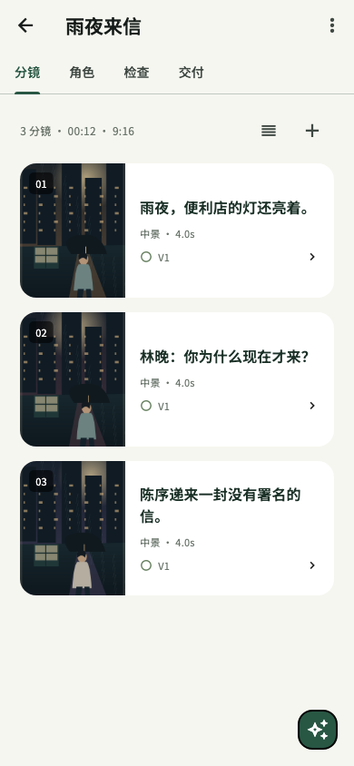
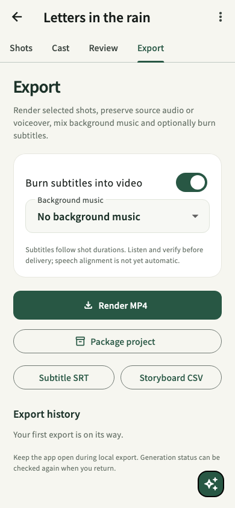
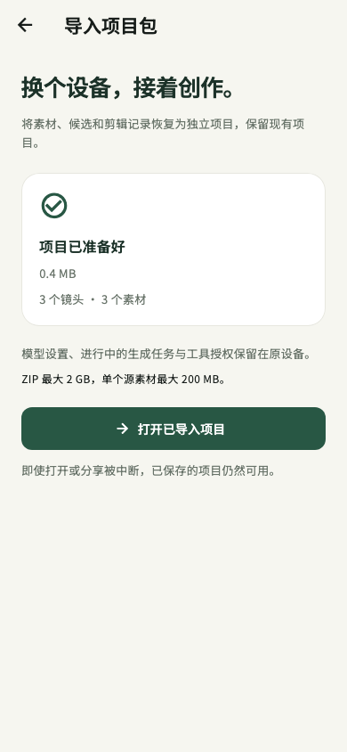
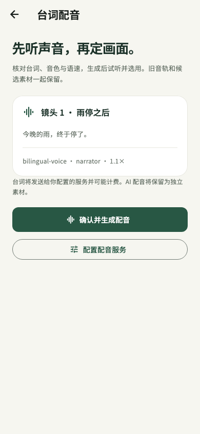
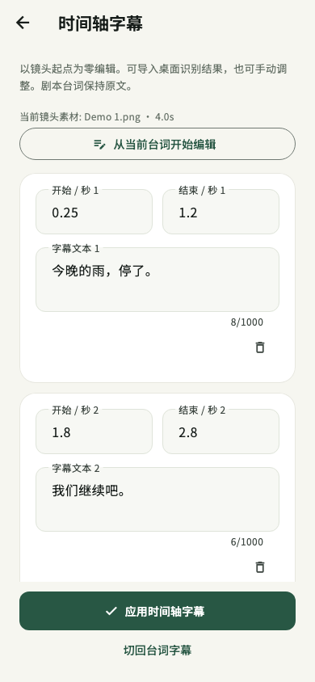

# 截图与阶段进度

2026-11-05。持续保存关键页面，供产品评审对照。以下图片由真实 Flutter 组件树在 390 × 844 的界面测试中渲染，使用本地示例插画与中英文字体；素材标注为演示，图片不代表模型生成质量。

截图快照：`2026-11-05-0045`（Asia/Shanghai）。本次快照独立保存，后续测试不会覆盖这些历史图片。

## 本轮界面

| 页面       | 中文                                               | English                                            |
| ---------- | -------------------------------------------------- | -------------------------------------------------- |
| 项目首页   | [查看](progress/2026-11-05-0045/library-zh.png)    | [View](progress/2026-11-05-0045/library-en.png)    |
| 分镜列表   | [查看](progress/2026-11-05-0045/storyboard-zh.png) | [View](progress/2026-11-05-0045/storyboard-en.png) |
| 镜头与候选 | [查看](progress/2026-11-05-0045/shot-zh.png)       | [View](progress/2026-11-05-0045/shot-en.png)       |
| 角色参考   | [查看](progress/2026-11-05-0045/cast-zh.png)       | [View](progress/2026-11-05-0045/cast-en.png)       |
| 导出设置   | [查看](progress/2026-11-05-0045/export-zh.png)     | [View](progress/2026-11-05-0045/export-en.png)     |

## 这轮已落实的改动

- 手机采用 Flutter 独立本地引擎，替换早期 Capacitor / 必须连接工作站的方案。
- 中英文 UI、SQLite 项目、设备安全存储、BYOK 直连、素材导入、候选对比、剪辑排序与裁切、原生导出接口和系统分享。
- 手机 Agent 具备读取项目、检查、逐镜修改、分镜创建、排序、Skills 和 HTTP MCP 请求；外部执行经过产品内确认。
- 桌面增加排序、裁切和字幕/音频处理；改变素材与检查依据会使过时的检查失效。
- 官网增加完整英文页，部署保持私有；中英文交互演示均有内存 DOM 测试。
- 竞品核对结果已转成带来源、差距和验收标准的清单。

## 界面取证限制

本地 `127.0.0.1:5173`、已部署官网的浏览器打开请求，以及 iOS Simulator 界面读取均被当前权限策略拒绝。没有改用其他浏览器或系统截图命令获取这些被拒绝的界面。组件渲染截图、平台构建、原生执行记录分别保存；本页没有声称已完成浏览器或真机视觉验收。

## 官网视觉第二版（已部署）

按用户的新反馈，调整为更年轻的深色创作台视觉：高对比字体、亮绿色操作、霓虹电影感概念封面、镜头卡与可控时间线动效。同步维护中英文和窄屏布局。概念图由内置 imagegen 生成，标注为概念视觉；不是软件生成效果的测评证据。现有单镜候选与版本回选演示继续可用。

浏览器对当前官网标签页的内容读取仍被保存的权限策略拒绝；没有改用其他浏览器或间接截图绕过。本次中英文官网的 10 项静态/交互检查通过，CSS 解析和 JS 语法检查通过。已部署到原私有地址；源码提交 `71a145002a045e791c63cc625f298bb57521b203`。实际浏览器视觉验收仍单独记录。

## 客户端 0.1.2（2026-11-05）

已交付实际 Windows x64、Mac Apple Silicon 与 Android ARM64 预览安装包，见 [客户端入口](CLIENT-PREVIEWS.md)。桌面增加项目包导入与中英文状态，修复后台刷新导致弹窗焦点跳动；Android 优化包约 34 MB。新增 11 项 Node/内存 UI 用例，全量 152 项通过。

这轮界面变化没有新的系统截图：浏览器/Simulator 观察限制未解除，没有通过替代工具获取。Mac 包内核心引擎已执行通过；Windows 仅完成交叉构建及结构检查，Android 仅完成优化构建与签名元数据检查。用户允许先交付 Windows 预览，继续开发。

## 手机项目包（0.1.3 开发预览）

新增手机项目打包与导入、实际进度、取消、错误保留、恢复项目打开，以及导入完成但界面刷新失败时的安全重试。两套引擎实际往返了包含媒体的项目，而非仅比较 JSON。

最新独立快照：[2026-11-05-mobile-package](progress/2026-11-05-mobile-package/snapshot.json)，共 14 张 390 × 844 的 Flutter 组件截图；含原有五页中英文与新增导入前/完成两种状态中英文。截图不是系统或真机截图。

| 新增状态 | 中文                                                               | English                                                            |
| -------- | ------------------------------------------------------------------ | ------------------------------------------------------------------ |
| 选包后   | [查看](progress/2026-11-05-mobile-package/package-ready-zh.png)    | [View](progress/2026-11-05-mobile-package/package-ready-en.png)    |
| 导入完成 | [查看](progress/2026-11-05-mobile-package/package-complete-zh.png) | [View](progress/2026-11-05-mobile-package/package-complete-en.png) |

## 桌面 0.1.3：台词配音

增加语音服务设置、发送前台词/模型/音色/语速确认、配音任务、独立 WAV 素材与试听、音轨过长提示；已创建任务刷新失败时不重复提交。中英文组件测试和真实媒体测试已接入，使用现有 FFmpeg 验证文件与混音。手机的在线配音界面尚未接入。

本轮没有新的桌面系统截图：浏览器与 Electron 界面观察限制仍存在，没有使用其他方式取得受限界面。组件测试不构成浏览器视觉验收。已保存的手机截图仍可供页面评审。

## 手机 0.1.4：配音与试听

新增语音服务配置、保存草稿后的确认页、实际配音队列、WAV 素材、播放/暂停/重播/拖动与音轨过长提示。任务已创建而刷新失败时保留任务 ID，重试只刷新。切页面/后台暂停试听。完整 Flutter 回归 67 通过，新增 23 项，涵盖真实 WAV 与本地 HTTP 取消；真实设备播放和供应商发音质量仍待验收。

独立快照：[2026-11-05-mobile-voiceover](progress/2026-11-05-mobile-voiceover/snapshot.json)，共 20 张 390 × 844 的组件渲染。新增如下六张，保留此前的项目/分镜/候选/角色/导出/迁移页面。配音测试音频是本地正弦 WAV，播放器状态使用可控控制器；不是付费供应商生成结果或原生设备截图。

| 新页面/状态    | 中文                                                                   | English                                                                |
| -------------- | ---------------------------------------------------------------------- | ---------------------------------------------------------------------- |
| 配音确认       | [查看](progress/2026-11-05-mobile-voiceover/voiceover-ready-zh.png)    | [View](progress/2026-11-05-mobile-voiceover/voiceover-ready-en.png)    |
| 配音完成       | [查看](progress/2026-11-05-mobile-voiceover/voiceover-complete-zh.png) | [View](progress/2026-11-05-mobile-voiceover/voiceover-complete-en.png) |
| 试听与时长提示 | [查看](progress/2026-11-05-mobile-voiceover/audio-preview-zh.png)      | [View](progress/2026-11-05-mobile-voiceover/audio-preview-en.png)      |

## 桌面 0.1.4 / 手机 0.1.5：时间轴字幕

桌面增加 BYOK 分段语音识别、确认范围与费用、识别候选、试听与逐段起止时间/文字编辑。手机可编辑时间轴、导入桌面结果并按段渲染。字幕绑定实际音轨/剪辑范围，过期后提示更新。导出记录分别提供对应成片版本的 SRT。真实供应商识别准确率与原生手机效果仍待验证。

独立快照：[2026-11-05-captions](progress/2026-11-05-captions/snapshot.json)，共 22 张中英文 Flutter 组件渲染，390 × 844。新增字幕编辑页，更新导出帮助文字；保存按钮、错误与切回台词字幕固定在底部。没有访问受限的浏览器、Electron 或 Simulator 窗口。

| 页面       | 中文                                                 | English                                              |
| ---------- | ---------------------------------------------------- | ---------------------------------------------------- |
| 时间轴字幕 | [查看](progress/2026-11-05-captions/captions-zh.png) | [View](progress/2026-11-05-captions/captions-en.png) |

## 手机 0.1.6 图片候选与首帧

镜头页新增图片生成和选中首帧入口。确认页显示模型、服务地址、参考图和提示词。六张快照来自 390 × 844 Flutter 组件测试，使用演示插画。

| 页面 | 中文 | English |
| --- | --- | --- |
| 镜头与候选 | [查看](progress/2026-11-05-mobile-generation/shot-zh.png) | [View](progress/2026-11-05-mobile-generation/shot-en.png) |
| 图片确认 | [查看](progress/2026-11-05-mobile-generation/image-review-zh.png) | [View](progress/2026-11-05-mobile-generation/image-review-en.png) |
| 首帧视频确认 | [查看](progress/2026-11-05-mobile-generation/first-frame-review-zh.png) | [View](progress/2026-11-05-mobile-generation/first-frame-review-en.png) |
